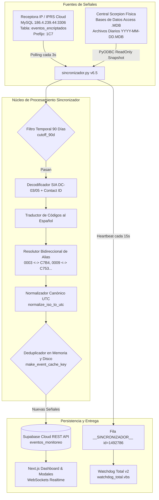

# ARQUITECTURA TÉCNICA Y DIAGNÓSTICO PROFUNDO DEL SINCRONIZADOR
**Gama Seguridad - Monitoreo Online v6.5**
*Documentación Técnica Oficial de Sincronización, Normalización y Resiliencia*

---

## 1. Visión General del Sistema
El subsistema de sincronización es el motor neurálgico de Gama Seguridad que ingesta, traduce, desduplica y persiste en tiempo real las señales de alarma provenientes de múltiples receptoras hacia Supabase (PostgreSQL Cloud) y la interfaz de usuario en Next.js.



---

## 2. Diagnóstico Profundo: Causas Raíz y Soluciones Implementadas

### Causa Raíz 1: Ventana de Deduplicación Excesiva en Frontend
- **Problema Detectado**: En `TodosLosEventosModal.tsx` y `ScorpionDashboard.tsx`, la lógica histórica agrupaba eventos por:
  ```ts
  Math.round(fecha.getTime() / 45000) // o 35000
  ```
  y usaba únicamente `${cuenta}-${evento}-${bloque}`.
- **Impacto**: Si un panel enviaba múltiples señales de alarma en diferentes zonas (ej: Zona 001 Robo, Zona 002 Robo) dentro de 45 segundos, o múltiples aperturas/cierres consecutivos, el segundo evento era destruido silenciosamente en el modal.
- **Solución Implementada**:
  - Se redujo la ventana de deduplicación a **3 segundos** (`3000 ms`).
  - Se incorporaron obligatoriamente `${zona}` y `${usuario}` en la clave única:
    ```ts
    const key = `${e.cuenta}-${e.evento}-${e.zona || ''}-${e.usuario || ''}-${Math.round(ts / 3000)}`
    ```
  - Se garantiza que jamás se oculten eventos legítimos de zonas distintas o re-disparos.

---

### Causa Raíz 2: Dualidad de Cuentas (C7 IP vs Numérica Scorpion)
- **Problema Detectado**: 45 cuentas físicas activas transmiten por IP a través de la receptora `1C7` con identificadores hexadecimales `C7XX` (por ejemplo: `C7B4`, `C753`, `C760`), pero en la base de datos Scorpion y en la mente del operador figuran como `0003`, `0009`, `0668`.
- **Impacto**: Al abrir el modal "Eventos por Usuario" o buscar `0003`, la consulta a Supabase buscaba exclusivamente `cuenta = '0003'`, mostrando 0 eventos recientes porque todos entraban como `C7B4`.
- **Solución Implementada**:
  - Módulo [dashboard/src/lib/alias_cuentas.ts](file:///c:/Users/tetor/Downloads/MONITOREO%20ONLINE/monitoreo-online/dashboard/src/lib/alias_cuentas.ts) con 90 asignaciones bidireccionales.
  - Función `getAccountAliases(cuenta)` que expande cualquier cuenta a todas sus variantes (`0003` -> `['0003', '3', 'C7B4']`).
  - En `EventosPorUsuarioModal.tsx`:
    ```ts
    const aliases = getAccountAliases(cuentaActiva)
    query.in('cuenta', aliases)
    ```
  - En `sincronizador.py`: Búsqueda cruzada de nombres con `get_nombre_cliente_con_alias(cuenta)`. Cuando ingresa `C7B4`, busca automáticamente el nombre asociado a `0003`, evitando el genérico `"ABONADO C7B4"`.

---

### Causa Raíz 3: Descarte de Cuentas Sin Catalogar
- **Problema Detectado**: En `ScorpionDashboard.tsx`, existía la siguiente validación:
  ```ts
  if (cuenta.startsWith('ABONADO ') && !clientesMap[cuenta]) return false
  ```
- **Impacto**: Clientes nuevos o paneles con numeración especial eran descartados de la vista principal.
- **Solución Implementada**: Se eliminó esa exclusión. Cualquier abonado con prefijo `ABONADO ` es visible de inmediato para auditoría del operador.

---

### Causa Raíz 4: Discrepancia de Zona Horaria en el Cache del Sincronizador
- **Problema Detectado**:
  - Al insertar, `sincronizador.py` generaba `fecha_hora` con formato Chile Continental (`-03:00`).
  - Al reiniciar el script, `load_cache()` consultaba Supabase, que devolvía las fechas en formato UTC (`+00:00` o `Z`).
  - Como la clave era string literal (`f"{fecha_hora}_{cuenta}..."`), `"2026-10-20T13:00:00-03:00"` no coincidía con `"2026-10-20T16:00:00+00:00"`, invalidando el cache y reinsertando eventos.
- **Solución Implementada**:
  - Función `normalize_iso_to_utc(iso_str)` que transforma cualquier ISO a representación estándar UTC (`YYYY-MM-DDTHH:MM:SS`).
  - `make_event_cache_key(...)` normaliza todas las claves antes de comparar o guardar en memoria/disco.

---

### Causa Raíz 5: Filtro Estricto de 90 Días (3 Meses)
- **Instrucción de Negocio**: Solo sincronizar y mantener activos los clientes y eventos con señales en los últimos 3 meses (90 días).
- **Solución Implementada**:
  - En `get_archivos_mdb_activos()`: Excluye automáticamente cualquier archivo MDB anterior a 90 días (`datetime.now() - timedelta(days=90)`).
  - En `sincronizar_desde_mysql()`: Regla estricta:
    ```python
    cutoff_90d = datetime.now() - timedelta(days=90)
    if ev_date < cutoff_90d or ev_date > datetime.now() + timedelta(days=1):
        continue
    ```
  - En `sincronizar_desde_mdb()`: Misma regla de retención de 90 días.

---

## 3. Protocolos de Resiliencia y Alta Disponibilidad

1. **Prevención de Bloqueos de Archivo (Access Driver)**:
   - Los archivos `.MDB` de Scorpion se copian primero a un archivo temporal (`_EVENTOS_TEMP.MDB`) con reintentos y lectura exclusiva `ReadOnly=1`.
   - Se mantiene un cache de passwords probadas exitosamente (`PASSWORDS_PROBAR_MDB`) para evitar agotar handles de pyodbc.
   - Si se detecta el código `1036` (demasiadas conexiones de cliente Access), el script aplica un backoff progresivo de 300ms a 500ms.

2. **Dead-Letter Queue (Sin Pérdida de Tramas)**:
   - Si una trama SIA o Contact ID no coincide con las expresiones regulares estándar, se extrae el abonado por fallback `#([A-Za-z0-9]{3,6})` o `18([A-Za-z0-9]{4})`.
   - La trama cruda se guarda en `_tramas_no_reconocidas.log` y se sube como `SEÑAL SIN IDENTIFICAR [{trama}]` a la zona `00`, garantizando que ninguna señal se pierda en el limbo.

3. **Watchdog Autónomo (watchdog_total.vbs)**:
   - Se ejecuta en segundo plano bajo `wscript.exe`.
   - Monitorea simultáneamente el proceso `pythonw.exe` y la frescura del heartbeat (`_sincronizador_heartbeat.txt`).
   - Si el proceso muere o el heartbeat no se actualiza en más de 120 segundos, el watchdog liquida el proceso congelado y lo reinicia automáticamente.
   - Se auto-registra en el inicio de Windows (`Shell:Startup\WatchdogGamaSeguridad.lnk`).

4. **Heartbeat Remoto en Supabase**:
   - Cada 15 segundos, el sincronizador envía un parche a la fila `id=1492786` (`__SINCRONIZADOR__`), permitiendo al dashboard web mostrar en vivo el badge de estado "PC CENTRAL EN LÍNEA".

---

## 4. Mapa de Archivos Modificados

| Archivo | Rol | Mejoras Aplicadas |
|---|---|---|
| `sincronizador.py` | Servicio de Ingesta Principal | Normalización UTC, clave indestructible de cache, resolución de alias de abonados, filtro estricto de 90 días, ampliación masiva de diccionario SIA/CID. |
| `SCORPION_DEPLOY/sincronizador.py` | Ejecutable en Servidor | Espejo idéntico 1:1 de `sincronizador.py`. |
| `dashboard/src/lib/alias_cuentas.ts` | Diccionario de Alias Frontend | 90 asignaciones bidireccionales de cuentas C7 a numéricas. |
| `dashboard/src/lib/alias_cuentas.json` | Diccionario de Alias Backend | Formato JSON consumido directamente por Python. |
| `dashboard/src/components/TodosLosEventosModal.tsx` | Visor Global de Eventos | Deduplicación a 3s con zona/usuario, buscador con alias, render reactivo de `eventosMostrados`. |
| `dashboard/src/components/EventosPorUsuarioModal.tsx` | Visor Individual de Cliente | Expansión de cuenta mediante `.in('cuenta', aliases)` en Supabase y Realtime. |
| `dashboard/src/components/ScorpionDashboard.tsx` | Panel Principal de Monitoreo | Deduplicación a 3s con zona/usuario, inclusión de `ABONADO ` sin catálogo, búsqueda expandida por alias. |
| `dashboard/src/lib/supabase.ts` | Cliente Base de Datos | Reducción de deduplicación global de 35s a 3s de precisión. |
